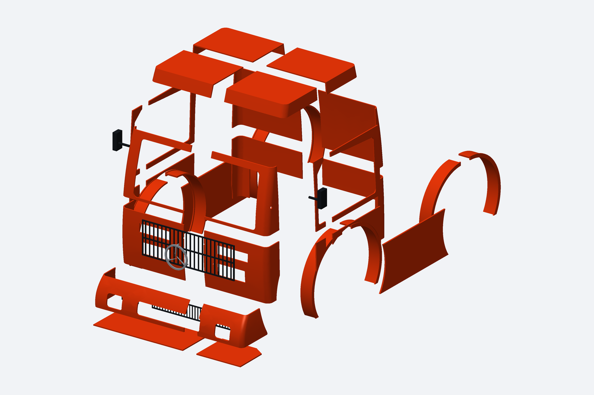
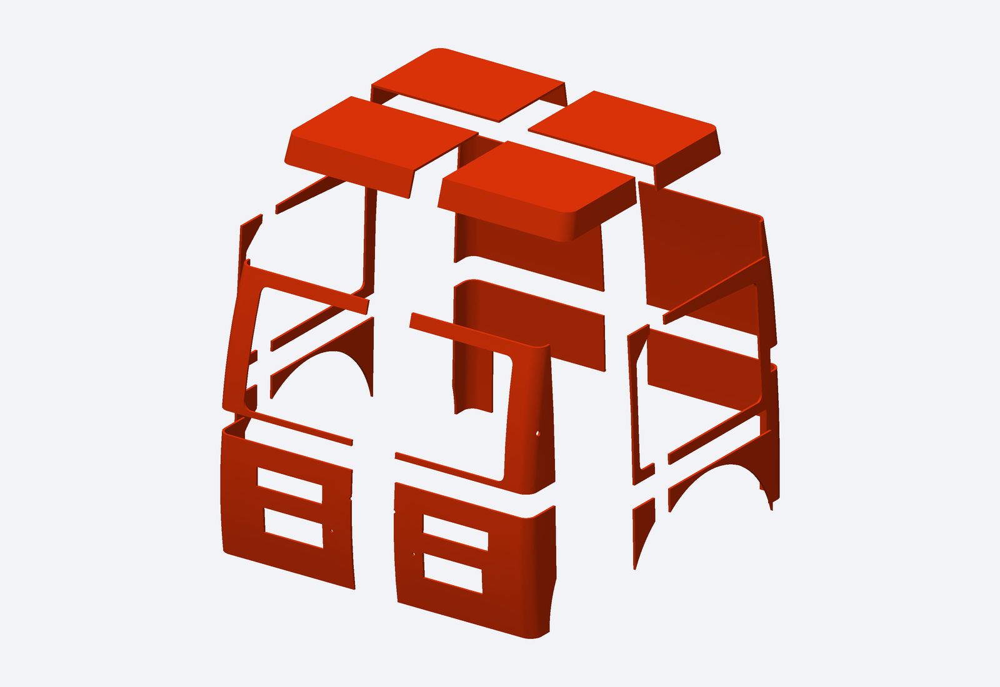

# Formula Truck — CAD com todas as peças soltas

[BAIXAR CAD COMPLETO — PEÇAS INDIVIDUAIS, MONTAGENS E STL](https://github.com/evildinomar2-dot/front-body-modular/raw/refs/heads/main/Formula_Truck/CAD_PECAS_SOLTAS/Formula_Truck_CAD_Pecas_Soltas.zip)

Entrega do mesmo modelo visual aprovado, com peças separadas para edição no Fusion e adaptação ao chassi pelo usuário. Não é um kit de travas/encaixes finais ou suportes específicos para o chassi.

## Conteúdo

- 47 STEP de carroceria, um sólido por arquivo: cabine em 20 painéis; para-choque em quatro seções; lâmina inferior em três; para-lamas em oito metades; quatro carenagens; duas grades; três telas; emblema e dois espelhos.
- 8 STEP opcionais de vidros/faixas, em pasta própria.
- Montagem de carroceria com 47 componentes e montagem opcional com os vidros, 55 componentes.
- STL individuais, STL orientados para a impressora, fontes CadQuery, lista de peças e relatórios.

Abra `MONTAGEM_TRUCK_CARROCERIA.step` ou um arquivo de `STEP_PECAS` no Fusion. Os STEP são sólidos com superfícies CAD, e não conversão de malhas STL; o histórico construtivo do CadQuery não é transferido para a linha do tempo do Fusion. Use `MONTAGEM_TRUCK_COM_VIDROS.step` para incluir os corpos opcionais.

Medidas de referência: entre-eixos 500 mm, pneus Ø200 mm, largura externa de pneus 400 mm; espelhos ultrapassam a largura nominal. A largura individual dos pneus não foi informada; 52 mm foi usada apenas como referência visual.

Cada peça teve seu envelope conferido em uma orientação dentro de 218 × 218 × 248 mm, para a impressora de 220 × 220 × 250 mm. O fatiamento, suportes, brim e a impressão física precisam ser conferidos pelo usuário. As metades e painéis têm cortes de separação sem travas mecânicas ou folgas calibradas. Colagem, uniões e adaptação ao chassi ficam a definir no CAD, conforme o pedido de entrega da geometria para adaptação própria.

Todos os 55 STEP foram reimportados como sólidos válidos individuais e as duas montagens reimportadas com 47 e 55 sólidos. Os STL foram reabertos como malhas fechadas. Não foi feita validação completa das interferências entre todos os componentes nem ensaio físico. Leia [as instruções completas](INSTRUCOES.md) e a [lista de peças](LISTA_PECAS.csv).

A prévia inicial e os projetos anteriores foram preservados.

[Vistas explodidas por três ângulos e download das imagens](VISTAS_EXPLODIDAS/README.md)
