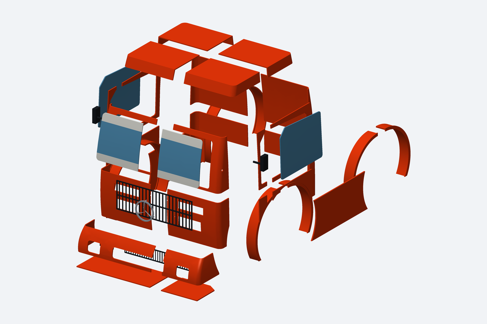
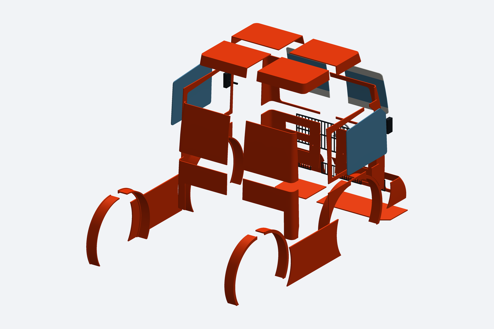
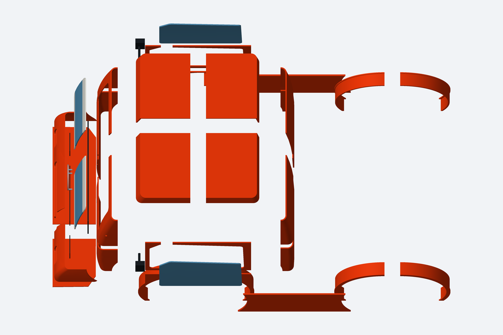

# Vistas explodidas do caminhão

Renderizações do CAD entregue: 47 peças de carroceria e 8 vidros/faixas opcionais. A separação é ilustrativa, sem representar encaixes ou sequência de montagem.

[Baixar as três imagens em ZIP](Formula_Truck_Explodido_3_Angulos.zip)

## Frente em perspectiva

## Traseira em perspectiva

## Superior em perspectiva

