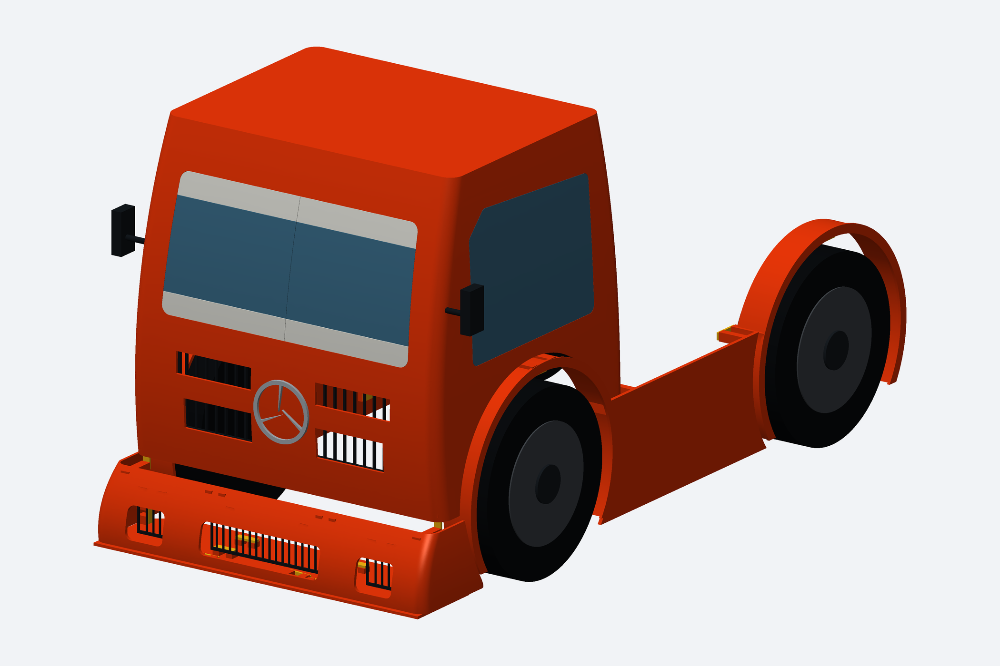
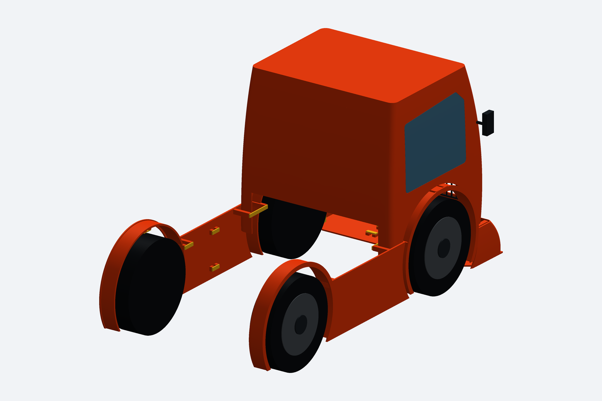
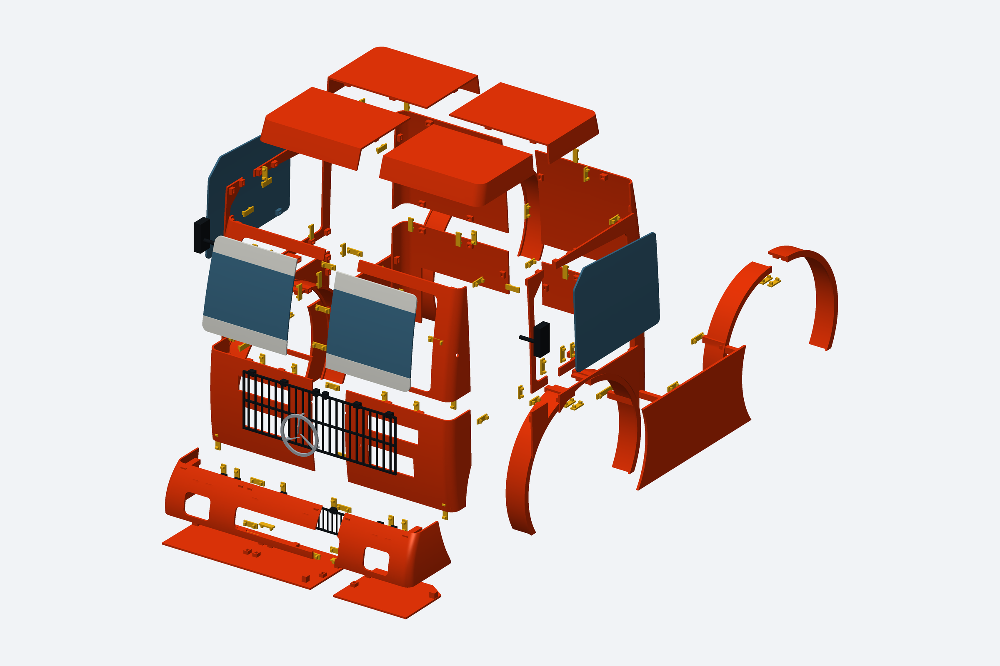

# Projeto V2 montado e explodido

[Baixar as três imagens](Formula_Truck_V2_3_Imagens.zip)

Renderizações do CAD com encaixes. As rodas nas vistas montadas são referências visuais; chassi e mecânica não estão representados. Chavetas em amarelo.

## Montado pela frente

## Montado pela traseira

## Explodido com encaixes

