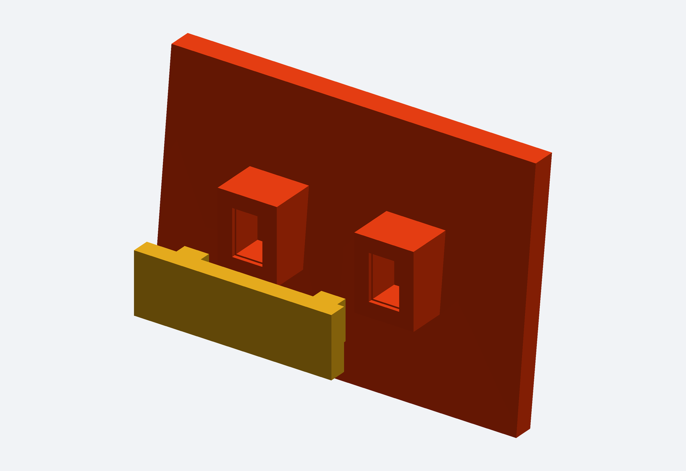
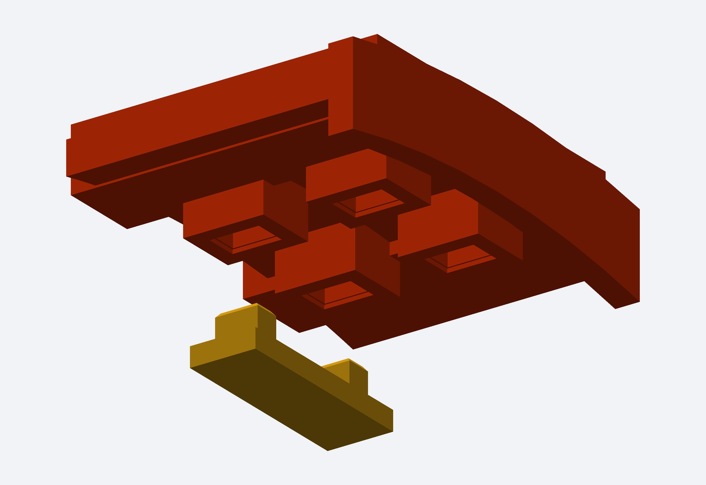

# Caminhão V2 — encaixes internos para colar

Os 47 painéis agora têm alojamentos/reforços internos. Há 84 chavetas para a carroceria e 13 para os oito vidros/faixas opcionais. Emblema e espelhos usam seus pinos/hastes originais. Todas as peças continuam separadas, dentro da impressora 220 × 220 × 250 mm.

**Use os painéis V2. Não misture com os painéis do pacote anterior sem encaixes.**

- [Baixar pacote completo CAD + STL com encaixes](Formula_Truck_V2_Com_Encaixes.zip)
- [Baixar primeiro o teste de encaixe — 50 KB](Teste_Encaixe_02mm.zip)
- [Instruções e ordem de montagem](LEIA_PRIMEIRO.md)
- [Mapa: qual chaveta une cada par de peças](MAPA_UNIOES.csv)
- [Lista de peças e dimensões](LISTA_PECAS.csv)
- [Validação digital](VALIDACAO.json)

Folga dos encaixes retangulares: 0,2 mm por face. Imprima dois alojamentos e uma chaveta do teste antes dos painéis grandes. A união definitiva usa cola compatível com o filamento. Não houve montagem física; a fixação ao chassi fica com o usuário, como combinado.

## Detalhe de uma união interna

Recorte do CAD entregue. Laranja: painéis e alojamentos. Amarelo: chaveta solta para alinhar e colar.

## União das metades de um para-lama

A conferência digital não encontrou interpenetrações acima de 0,15 mm³ nem invasão dos pneus de referência. Os STL foram gerados com desvio absoluto de 0,025 mm, sem reparos de malha.
