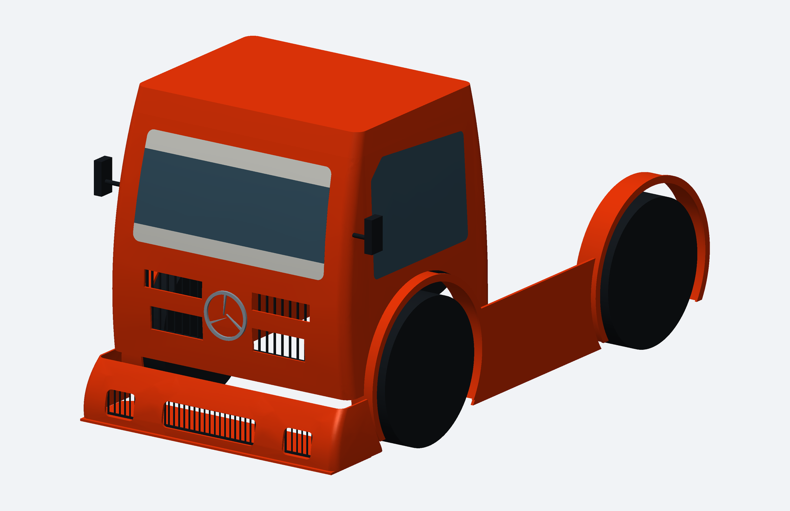

# Formula Truck 400 mm — estudo inicial, não é o kit final

[BAIXAR PRÉVIA CAD PARA INSPEÇÃO NO FUSION](https://github.com/evildinomar2-dot/front-body-modular/raw/refs/heads/main/Formula_Truck/ESTUDO_01/Formula_Truck_ESTUDO_01_NAO_IMPRIMIR.zip)

Este é um estudo CAD de carroceria e cabine inspirado na fotografia fornecida, não uma reprodução dimensional exata do Mercedes-Benz real. Não imprimir como kit final: faltam os encaixes, fixações no chassi e validações da montagem.

Dados confirmados: entre-eixos de 500 mm; rodas com pneus em torno de 200 mm de diâmetro externo; impressora 220 × 220 × 250 mm; referência de largura de 400 mm. O usuário confirmou que os 400 mm são medidos de fora a fora dos pneus. A largura dos pneus e os pontos de fixação do chassi não foram informados. Esses dados alteram posições de para-lamas e suportes. A altura da cabine e as demais proporções foram estimadas visualmente e são provisórias.

Os pneus e os vidros escuros mostrados nas imagens são referências visuais. A largura de pneus de 52 mm usada na imagem é provisória; não foram desenhados pneus ou rodas funcionais para fabricar. Os espelhos ultrapassam a largura nominal da carroceria. Os STEP contêm os componentes da carroceria, sem os volumes de referência de pneus e vidros.

ESTUDO_CARROCERIA_400MM.step contém os grupos lógicos da carroceria. ESTUDO_DIVISAO_CABINE.step contém uma divisão preliminar da cabine em 20 painéis; o envelope foi conferido contra 218 × 218 × 248 mm, deixando margem em relação à impressora de 220 × 220 × 250 mm. Essas orientações ainda não foram preparadas como STL de impressão. Encaixes e juntas continuam pendentes, portanto a divisão não é um kit de montagem pronto.

Os STEP foram reimportados como sólidos válidos em CadQuery/OpenCascade. Isso valida a geometria dos corpos, não compatibilidade com o chassi, ausência de todas as interferências ou comportamento mecânico. O Autodesk Fusion não foi executado no ambiente de preparação.

O modelo foi desenhado em CAD com superfícies de loft e formas analíticas. Não é conversão de uma imagem em malha nem uma cópia das peças do carro anterior. As fontes geram o estudo a partir de dimensões do código e parametros_estudo.json. Nem todos os detalhes são controlados apenas pelo JSON. Os imports e paths do renderizador usam o ambiente de preparação e ainda serão reorganizados no pacote final.

Projetos anteriores preservados. Este diretório é apenas uma prévia para conferir o tamanho e o aspecto antes de concluir o projeto.
