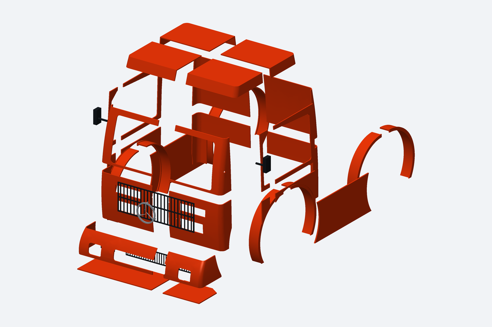

# Formula Truck — carroceria CAD 400 mm

[BAIXAR CAD COM TODAS AS PEÇAS SOLTAS](https://github.com/evildinomar2-dot/front-body-modular/raw/refs/heads/main/Formula_Truck/CAD_PECAS_SOLTAS/Formula_Truck_CAD_Pecas_Soltas.zip)

47 componentes de carroceria separados, oito vidros/faixas opcionais e montagens STEP para Fusion. Inclui STL individuais, versões orientadas para a impressora e fontes do CAD. A adaptação ao chassi e as uniões estruturais ficam a cargo do usuário; não é um kit com travas ou suportes finais detalhados.

[Instruções da entrega CAD](CAD_PECAS_SOLTAS/README.md) · [Prévia inicial preservada](ESTUDO_01/README.md)

