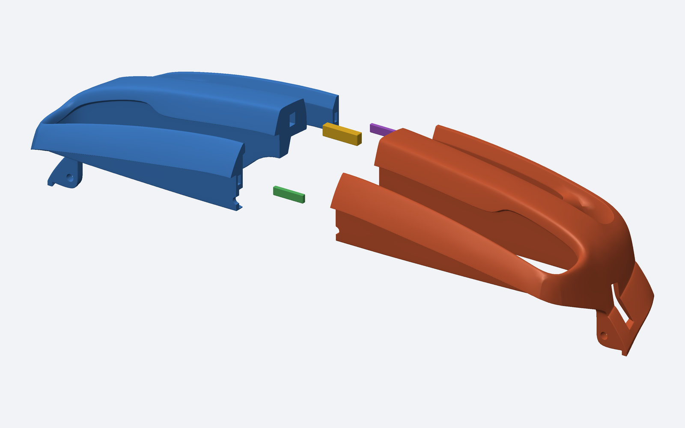
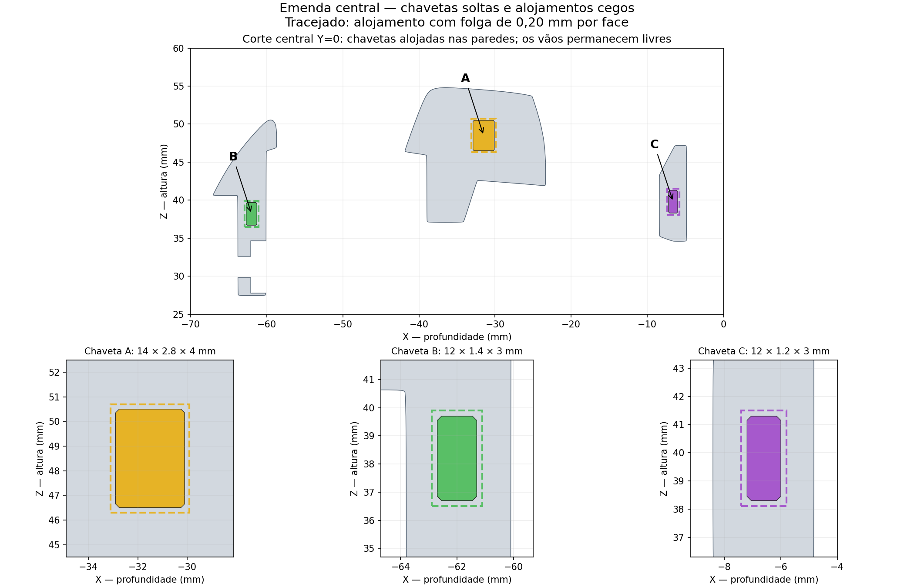

# Para-choque dianteiro dividido ao meio

[BAIXAR PACOTE COMPLETO — STL E STEP](https://github.com/evildinomar2-dot/front-body-modular/raw/refs/heads/main/Parachoque_dianteiro/Front_Bumper_Dividido_Fusion.zip)

Duas metades, três chavetas soltas e alojamentos cegos embutidos na espessura das paredes. Nenhuma travessa ou aba ocupa o vão da grade. Sem reescala do STL original.

## Imprimir

Extraia o ZIP e use os cinco arquivos de `STL_IMPRESSAO`: uma metade de cada lado e uma chaveta de cada tipo A, B e C. As metades têm dimensões de impressão aproximadas de **62,20 × 54,80 × 96,35 mm**, apoiadas na face do corte. As chavetas estão deitadas. A área útil da impressora não foi informada; confirme as dimensões e a orientação no fatiador. As peças foram centralizadas individualmente, portanto precisam ser arrumadas se importadas juntas.

Chavetas A: 14 × 2,8 × 4 mm; B: 12 × 1,4 × 3 mm; C: 12 × 1,2 × 3 mm. Folga nominal de 0,20 mm por face e 0,30 mm por extremidade; chanfros de 0,15 mm. São guias de alinhamento, sem trava elástica. A fixação permanente precisa ser definida conforme o material; a impressão, resistência e montagem física não foram testadas.

## Conferir a parede e a grade

Os alojamentos foram verificados como inteiramente contidos no material original. Cobertura mínima amostrada: aproximadamente 3,11 mm em A, 0,90 mm em B e 0,97 mm em C. A união das metades e chavetas não acrescenta material fora do corpo original, preservando os vãos da grade.

Os cinco STL de montagem e os cinco de impressão foram reabertos como malhas fechadas. Dez pares de componentes foram verificados, assim como cinco posições discretas de inserção em cada lado. Os cinco STEP e a montagem com cinco sólidos foram reimportados com sucesso em CadQuery/OpenCascade. Os STEP das metades são facetados, com simplificação adicional de 0,02 mm; as chavetas são sólidos analíticos chanfrados. O Fusion não foi executado nesta máquina.

Abra `MONTAGEM_PARACHOQUE_DIVIDIDO.step` no Fusion para inspeção CAD. `STL_MONTAGEM` contém posições de montagem; `STL_IMPRESSAO` contém as orientações individuais sugeridas para fatiar. Confira [as instruções completas](INSTRUCOES.md), inclusive suporte/brim e cuidado com alojamentos cegos. Não houve alinhamento com a carroceria nem ajuste ao chassi. Os pacotes anteriores estão preservados.
