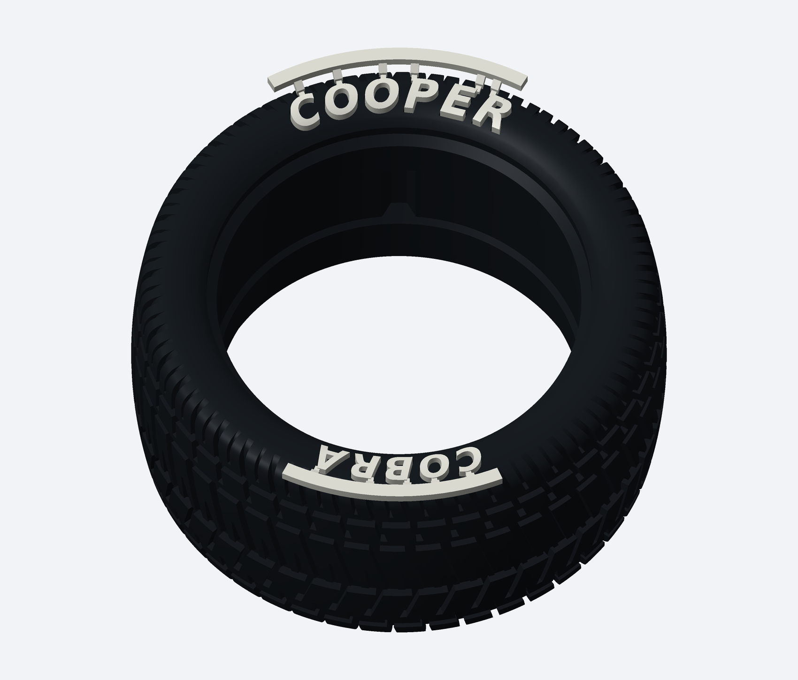

# COOPER / COBRA com letras em grades cortáveis

[Baixar o kit completo](Kit_Pneu_COOPER_COBRA_Com_Grade.zip)

COOPER em cima e COBRA embaixo. Rebaixos de 1 mm, letras de 2 mm com cerca de 1 mm exposto depois de colar. As pontinhas cortáveis têm seção de 0,8 × 0,6 mm.

Imprima o pneu em `STL_PNEU/Pneu_COOPER_COBRA_BaixoRelevo_1mm.stl` e as letras em `DUAS_GRADES_PARA_IMPRIMIR.stl`. Use o pneu específico deste pacote: os alojamentos GOODYEAR são diferentes. Há também arquivos individuais das duas grades.

Imprima primeiro os dois arquivos de teste O em `TESTE_ENCAIXE`. Confira suportes/brim no fatiador; não altere a escala. Cole as letras mantendo a grade, aguarde a cura e corte as pontinhas com alicate fino. A cor branca da prévia é apenas sugestão de filamento.

[Instruções completas, limites e fontes](LEIA_PRIMEIRO.md). Malhas e encaixes conferidos digitalmente; impressão e colagem ainda não ensaiadas fisicamente. As versões anteriores permanecem separadas.
