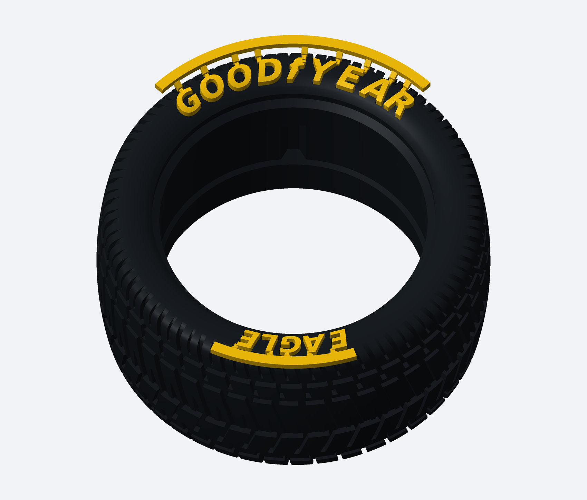
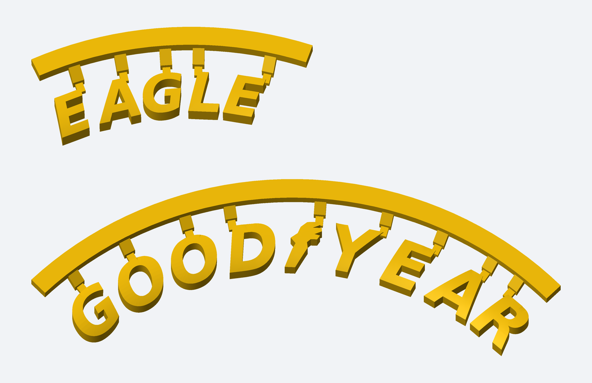
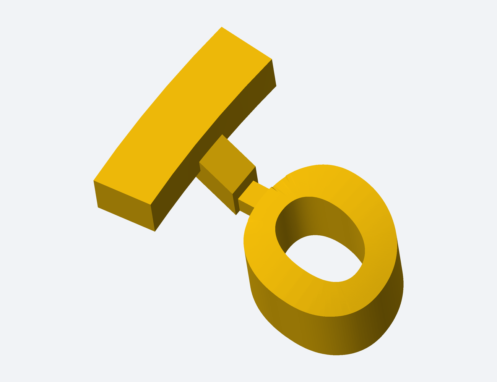

# Mesmo kit de pneu e letras, agora com grades de montagem cortáveis

[Baixar kit completo com as grades](Kit_Pneu_Letras_Com_Grade.zip)

Revisão pedida para facilitar impressão, manuseio e instalação. As letras ficam presas em duas grades curvas: uma de GOODYEAR e símbolo, outra de EAGLE. A posição e a curvatura das letras são as mesmas dos alojamentos. As ligações laterais pequenas têm seção nominal de 0,8 × 0,6 mm e podem ser cortadas com alicate fino depois da cura da cola.

O pneu com baixo relevo de 1 mm é exatamente o mesmo arquivo do kit anterior. As letras continuam com 2 mm de espessura, aproximadamente 1 mm para fora depois de encaixadas, folga lateral de 0,15 mm por face e reserva de 0,05 mm para cola.

## Imprimir

- Pneu: STL_PNEU/Pneu_Wide_L_BaixoRelevo_1mm.stl. Se já imprimiu esse modelo com rebaixos, pode aproveitar a peça.
- Letras com grades: DUAS_GRADES_PARA_IMPRIMIR.stl. Esse arquivo imprime dois conjuntos separados.
- GRADES_IMPRESSAO contém cada palavra separadamente, como alternativa ao arquivo duplo.
- TESTE_ENCAIXE contém a letra O com grade e o alojamento correspondente: teste ajuste, cola e corte antes de imprimir tudo.

Confira suportes sob as costas das letras e sob os arcos no fatiador. Remova os suportes automáticos mantendo intactas as grades e suas ligações. Encaixe a palavra inteira a seco, aplique a cola, aguarde a cura e então corte as pontinhas junto às letras, apoiando cada peça durante o corte. Retire a grade depois de cortar todas as ligações.

O conjunto foi conferido digitalmente como sólido conectado por palavra e sem interpenetração com o pneu na posição de instalação. Não houve ensaio físico. A aderência da Super Bonder depende dos filamentos escolhidos e deve ser conferida no teste O.

[Instruções completas](LEIA_PRIMEIRO.md) · [Validação](VALIDACAO.json)

## Grades na posição de instalação

## Arquivo para imprimir as duas grades

## Detalhe da ligação cortável no teste O

