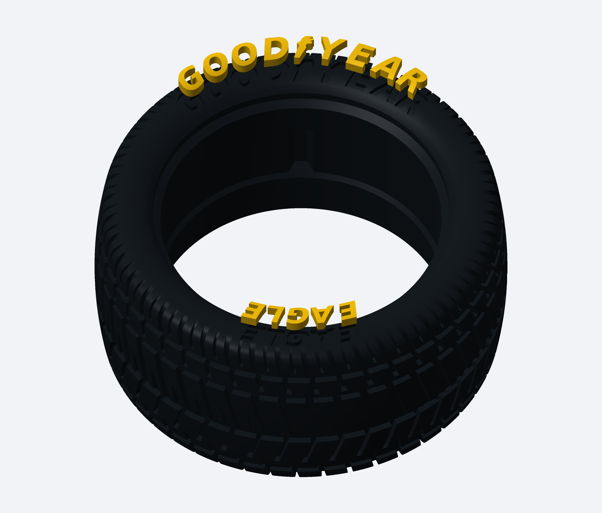
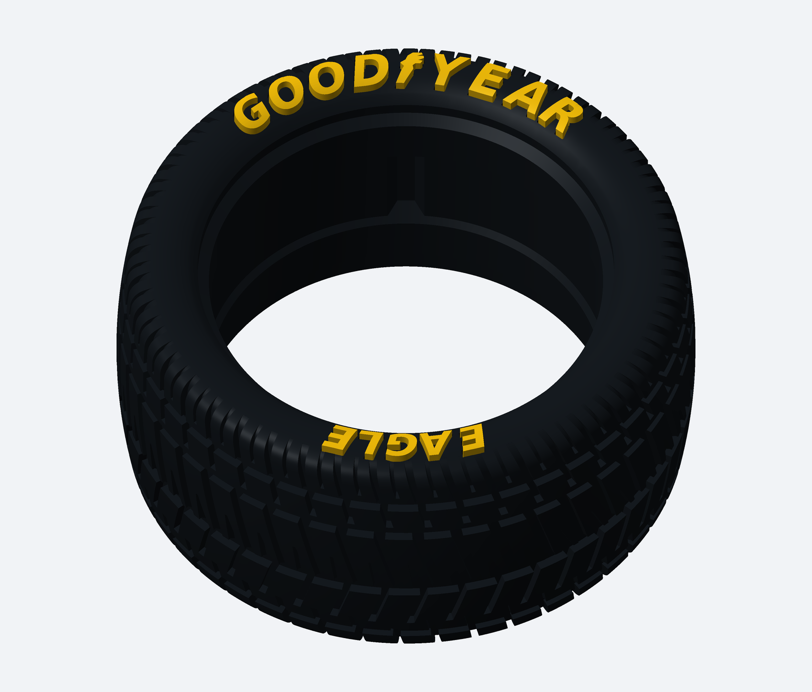

# Pneu com cavidades de 1 mm e letras separadas de 2 mm para colar

[Baixar o kit completo de impressão](Kit_Pneu_BaixoRelevo_1mm_Letras_2mm.zip)

Nova variante para imprimir o pneu numa cor e as inscrições em outra. O pneu tem cavidades com 1 mm de profundidade; as letras soltas têm 2 mm de espessura nominal. Montadas, ficam aproximadamente 1 mm para fora. A versão anterior com letras integradas continua salva separadamente.

## Imprimir

1. O pneu: STL_PNEU/Pneu_Wide_L_BaixoRelevo_1mm.stl.
2. As letras: TODAS_AS_LETRAS_2mm.stl. Há 14 peças separadas numa bandeja de aproximadamente 57 × 20 mm: 13 letras e o símbolo.

LETRAS_INDIVIDUAIS oferece os mesmos componentes individualmente para reimpressão. Não precisa imprimir a bandeja e os individuais juntos.

**Comece pelos dois arquivos em TESTE_ENCAIXE:** alojamento e letra O. Teste a seco e com a cola/filamentos escolhidos antes de fazer o conjunto inteiro. A aderência da Super Bonder depende dos materiais, especialmente em TPU. Não houve ensaio físico.

As letras acompanham a curvatura do pneu. Confira suportes leves nas costas e brim no fatiador. A altura da caixa envolvente pode superar 2 mm por causa dessa curvatura; não ajuste a escala Z para forçar 2 mm.

Folga lateral de 0,15 mm por face e reserva de 0,05 mm no fundo para película de cola. A saliência nominal montada é 1,05 mm. O espaçamento do arco superior foi ligeiramente aberto para manter as cavidades independentes. Encaixe na roda e banda de rodagem preservados.

[Instruções completas](LEIA_PRIMEIRO.md) · [Validação digital](VALIDACAO.json)

## Encaixe ilustrado

Letras afastadas na imagem apenas para visualizar os alojamentos.

## Pneu com as letras na posição final

## Bandeja das letras para imprimir em outra cor

