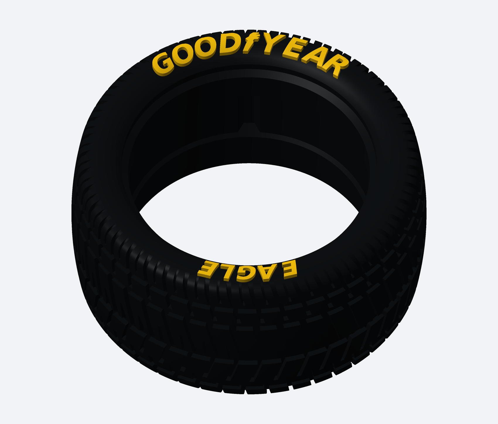

# Pneu Wide L — GOODYEAR / EAGLE, revisão com relevo de 1 mm

[Baixar a versão de 1 mm — STL e imagens](Pneu_Wide_L_GOODYEAR_EAGLE_1mm.zip)

Relevo reduzido de 2 para 1 mm, conforme solicitado. Tamanho, desenho e posição das inscrições preservados. GOODYEAR no arco superior e EAGLE no inferior, na lateral frontal, acompanhando a curvatura do pneu. O símbolo entre GOOD e YEAR é estilizado.

O STL é uma peça única fechada. Encaixe interno, banda de rodagem e outra lateral preservados. Diâmetro máximo aproximado 77,266 mm; largura máxima com o relevo de 1 mm aproximadamente 38,130 mm. O amarelo nas imagens indica pintura: STL não guarda cores.

Imprima STL_IMPRESSAO/Pneu_Wide_L_GOODYEAR_EAGLE_1mm.stl. Não houve ensaio físico: teste uma unidade antes do jogo completo.

[Instruções](LEIA_PRIMEIRO.md) · [Validação digital](VALIDACAO.json)

