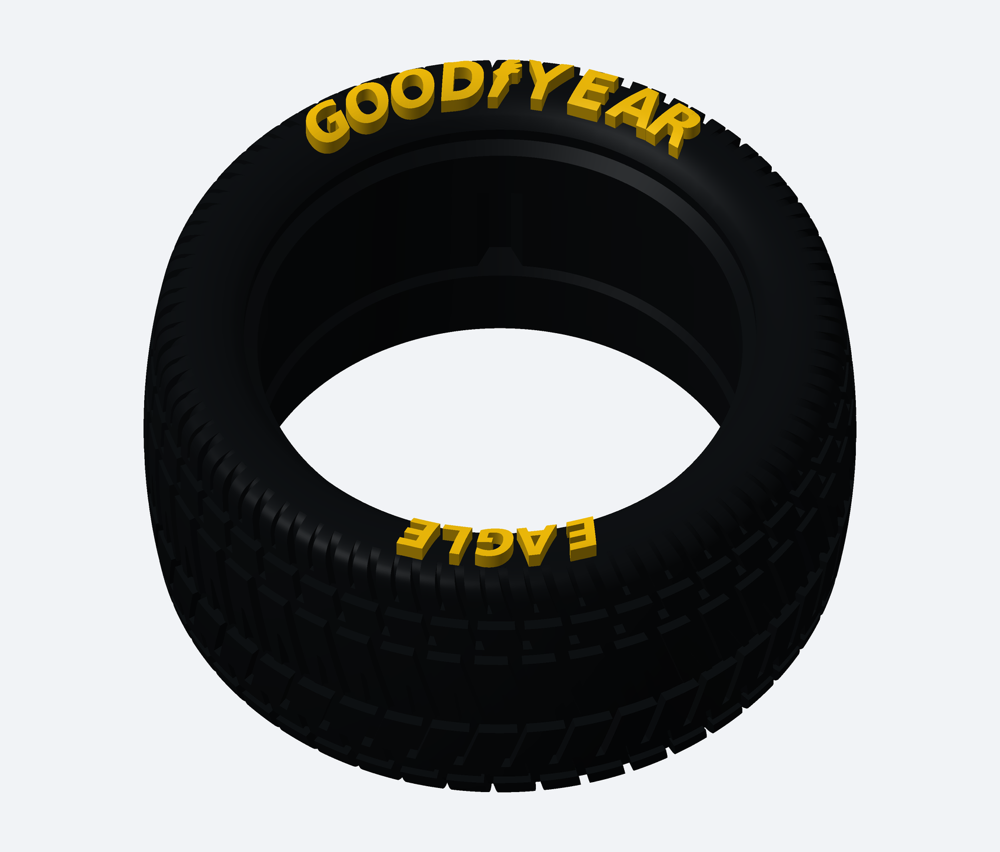

# Pneu Wide L — GOODYEAR / EAGLE com relevo de 2 mm

[Baixar o pneu em STL e as imagens](Pneu_Wide_L_GOODYEAR_EAGLE_2mm.zip)

GOODYEAR no arco superior e EAGLE no inferior, na lateral frontal do pneu original enviado. As letras acompanham a curvatura real, com relevo axial nominal de 2 mm e ancoragem de 0,35 mm. Há um símbolo de pé alado estilizado entre GOOD e YEAR. A tipografia é uma interpretação da referência, sem promessa de logotipo vetorial oficial.

O modelo final é uma única peça fechada. Encaixe interno, banda de rodagem e outra lateral foram preservados. Diâmetro máximo aproximadamente 77,266 mm; largura máxima com o relevo aproximadamente 39,130 mm. Não foi feito redimensionamento para outra roda.

**O amarelo na imagem é uma indicação de pintura. O STL não armazena cores e as letras estão integradas ao pneu.**

Imprima STL_IMPRESSAO/Pneu_Wide_L_GOODYEAR_EAGLE_2mm.stl. Teste uma unidade; não houve ensaio físico.

[Instruções](LEIA_PRIMEIRO.md) · [Validação digital](VALIDACAO.json)

