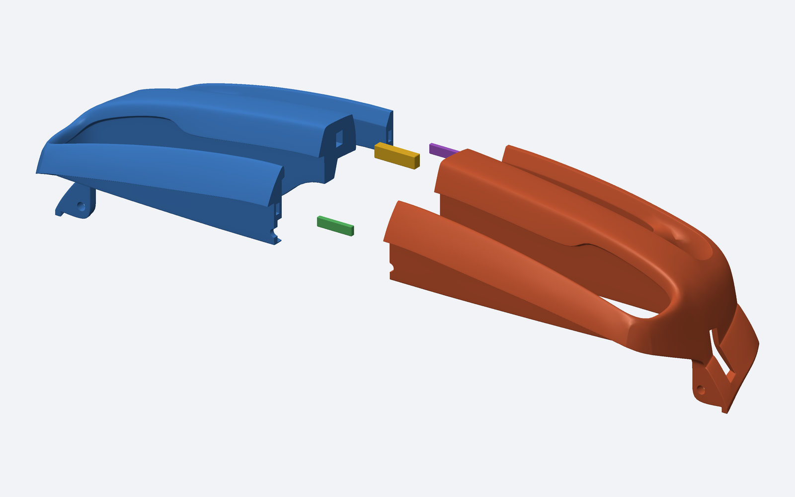
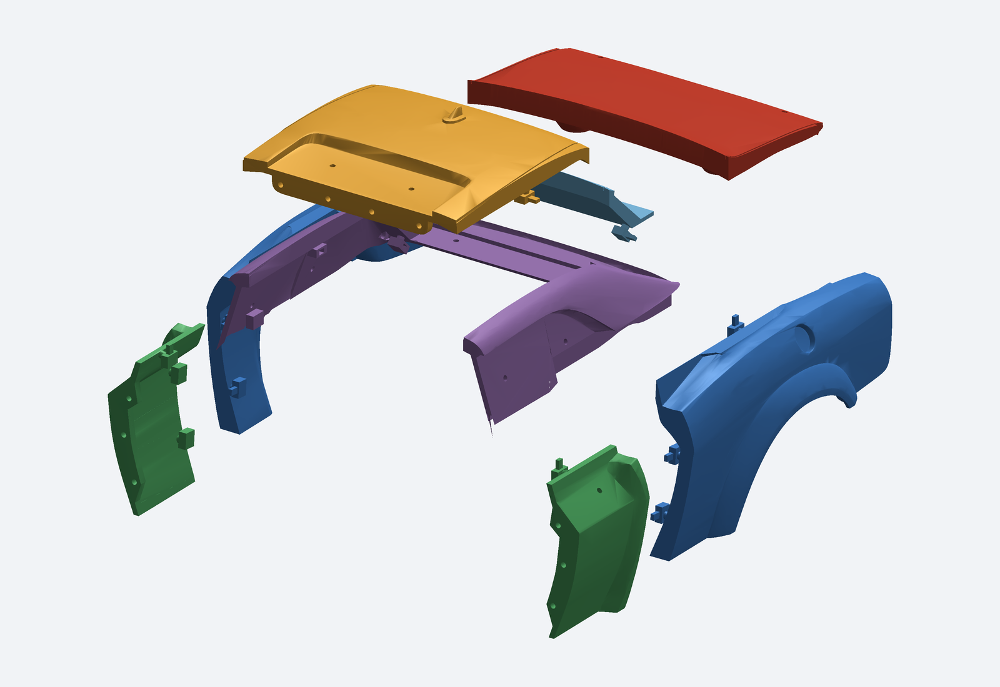
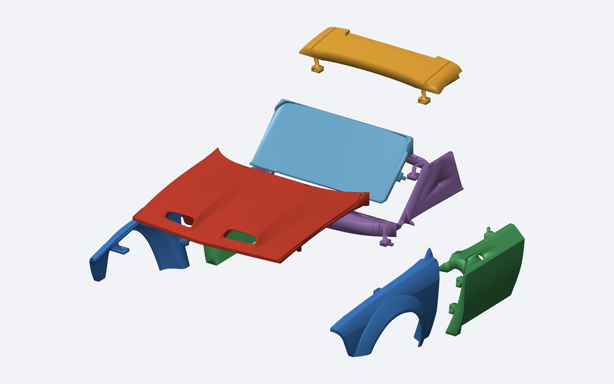
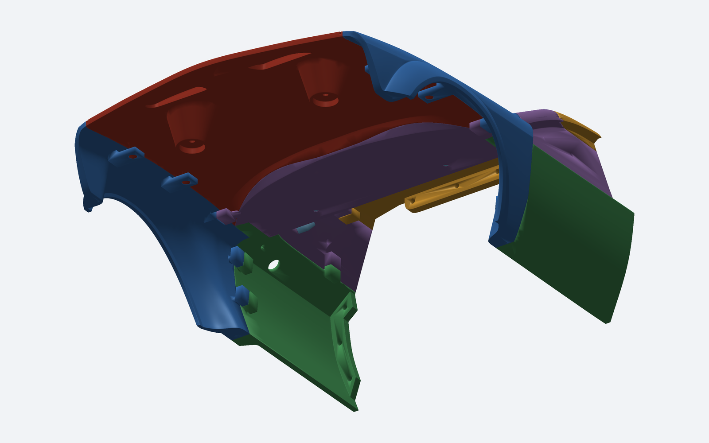

**Caminhão atualizado:** [V2 com encaixes internos para colar — CAD, STL e teste de folga](Formula_Truck/COM_ENCAIXES_V2/README.md).

# Carroceria modular para Fusion

## Formula Truck — CAD com peças soltas

[**BAIXAR CAD DO CAMINHÃO — PEÇAS INDIVIDUAIS E MONTAGENS**](https://github.com/evildinomar2-dot/front-body-modular/raw/refs/heads/main/Formula_Truck/CAD_PECAS_SOLTAS/Formula_Truck_CAD_Pecas_Soltas.zip)

47 componentes de carroceria e oito vidros/faixas opcionais em STEP, com STL e fontes. Mesmo modelo visual aprovado, separado para adaptação própria ao chassi; uniões e suportes finais não foram detalhados. [Instruções e peças](Formula_Truck/CAD_PECAS_SOLTAS/README.md).

---

## Para-choque dianteiro dividido

[**BAIXAR PARA-CHOQUE — DUAS METADES E TRÊS CHAVETAS**](https://github.com/evildinomar2-dot/front-body-modular/raw/refs/heads/main/Parachoque_dianteiro/Front_Bumper_Dividido_Fusion.zip)

Emenda por chavetas dentro das paredes, sem ocupar o vão da grade. Inclui STL orientados para impressão e montagem STEP. [Instruções e detalhes da emenda](Parachoque_dianteiro/README.md).

---

## Traseira — Rear Body V1

[**BAIXAR O PACOTE DA TRASEIRA**](https://github.com/evildinomar2-dot/front-body-modular/raw/refs/heads/main/Traseira/Rear_Body_Modular_Fusion.zip)

Oito peças separadas, guias internas e tampa do porta-malas removível, em STEP e STL. [Instruções e validações da traseira](Traseira/README.md).

---

## Dianteira — Front Body V1

[**BAIXAR O PACOTE COMPLETO — ZIP, aproximadamente 44 MB**](https://github.com/evildinomar2-dot/front-body-modular/raw/refs/heads/main/Pacote_completo_Fusion.zip)

Extraia o ZIP inteiro e abra `MONTAGEM_MODULAR.step` no Autodesk Fusion. O pacote também contém oito STEP individuais, oito STL, imagens, instruções, fontes e o STL original preservado. Não requer instalar Python para abrir os STEP.

## Peças

Capô, dois para-lamas, dois painéis laterais, painel do para-brisa, teto e moldura/calha/colunas. Escala numérica original mantida; unidade assumida: milímetro. Largura original aproximada de 197,56 mm.

## Encaixes e edição

O capô tem quatro pinos removíveis de Ø4,0 mm e alojamentos de Ø4,6 mm nos para-lamas. As demais peças têm guias internas de posicionamento para colagem ou fixação adicional a projetar, com folga nominal de 0,30 mm por lado. O capô não tem dobradiça e os encaixes não foram testados fisicamente. A adaptação ao chassi modificado ainda não foi feita.

Os STEP são sólidos BRep **facetados, derivados do STL**, sem recuperação de superfícies NURBS ou histórico paramétrico original. A versão CAD foi simplificada e teve ajustes locais; não misture STEP e STL ao montar um mesmo conjunto sem conferir os contatos. Não há para-choque completo no arquivo de origem.

A montagem STEP foi exportada e reimportada com oito sólidos válidos. Os arquivos individuais também foram reabertos; os pares foram verificados por interseção volumétrica com tolerância numérica. Esses testes foram feitos com CadQuery/OpenCascade; a importação no Fusion e a impressão física ainda não foram testadas.

Leia [as instruções completas](INSTRUCOES.md) antes de modificar ou imprimir. O pacote inclui um script opcional de conversão para F3D que deve ser executado dentro do Fusion; ele não foi executado na nuvem.

[Roda de sete raios nivelada com a borda — versão aprovada](Rodas/Sete_Raios_Nivelada/README.md).

[Roda de cinco raios largos estilo TC4 — frente nivelada](Rodas/Cinco_Raios_TC4_Nivelada/README.md).

[Pneu Wide L com GOODYEAR / EAGLE em relevo de 2 mm](Pneus/Wide_L_GOODYEAR_EAGLE_2mm/README.md).
