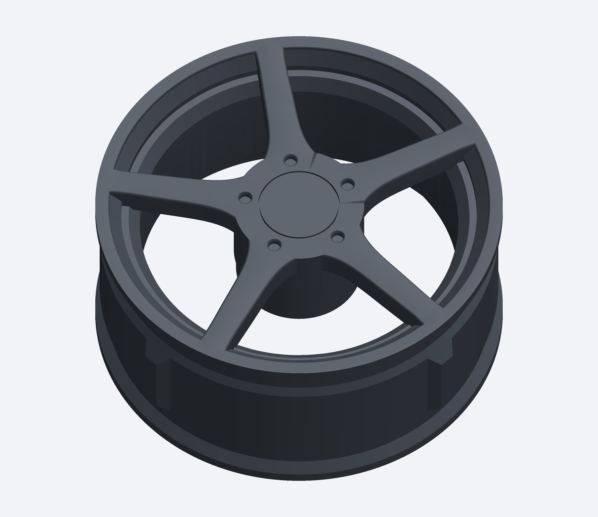
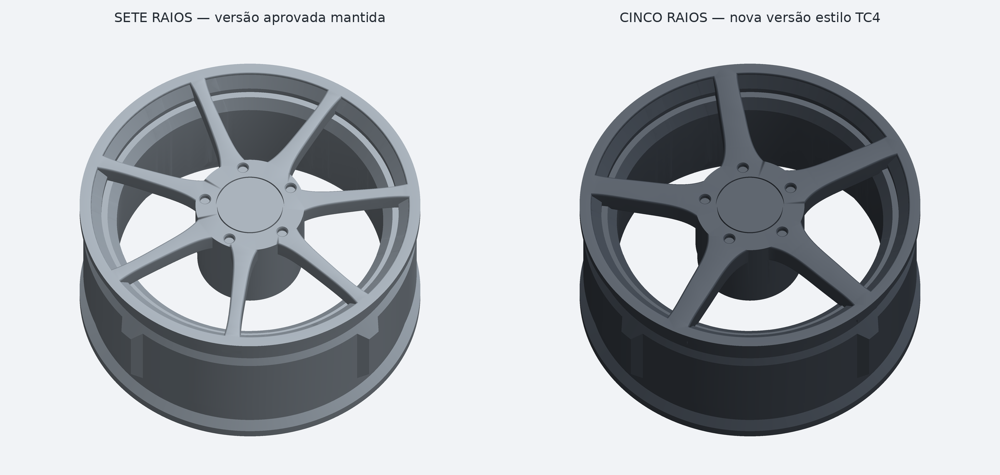

# Roda de cinco raios largos estilo TC4 — frente nivelada

[Baixar STL, tampa opcional, CAD da face e imagens](Roda_5_Raios_TC4_Nivelada.zip)

Desenho inspirado na fotografia enviada, usando a mesma base funcional e o mesmo alinhamento da roda de sete raios aprovada. Os raios, o miolo e a tampa ficam nivelados com a borda externa original. A versão de sete raios foi preservada.

Diâmetro máximo 56,5955 mm; largura 26,00 mm; furo de eixo 4 mm; hexágono traseiro 12,4 mm entre faces. Cubo funcional e assento do pneu preservados. A cor grafite é apenas a representação do CAD. Não há logotipos/inscrições e não é uma réplica medida do produto anunciado.

[Instruções](LEIA_PRIMEIRO.md) · [Validação digital](VALIDACAO.json)

Imprima STL_IMPRESSAO/Roda_TC4_Nivelada.stl. A tampa é opcional e está na mesma pasta. O STEP contém apenas a face nova; a roda completa está em STL. Não houve ensaio físico: teste uma unidade antes do jogo completo.

