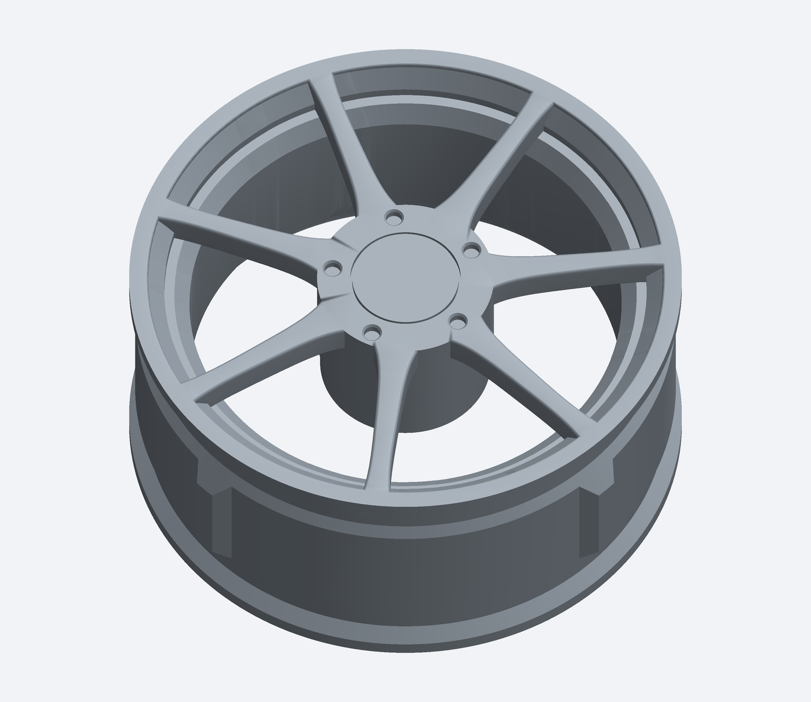
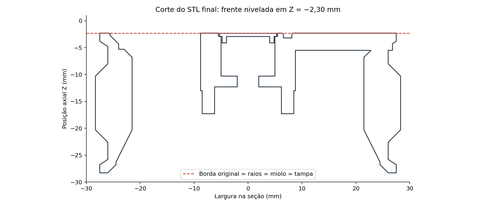

# Roda de sete raios nivelada com a borda — versão escolhida

[Baixar o pacote com STL da roda, tampa opcional, CAD da face e imagens](Roda_7_Raios_Nivelada_Borda.zip)

A frente dos raios, do miolo e da tampa está alinhada à borda externa original do aro. Diâmetro máximo 56,5955 mm; largura final 26,00 mm; furo central 4 mm; hexágono traseiro 12,4 mm entre faces. A geometria funcional de fixação e o assento externo do pneu foram preservados do STL de entrada. As outras versões de roda permanecem separadas no ambiente de trabalho.

[Instruções](LEIA_PRIMEIRO.md) · [Verificações digitais](VALIDACAO.json)

Imprima uma unidade para testar o encaixe e o pneu. Não houve ensaio físico. O STEP incluído contém somente a face nova; a roda completa é fornecida em STL. O STL original de entrada não é redistribuído neste pacote.

