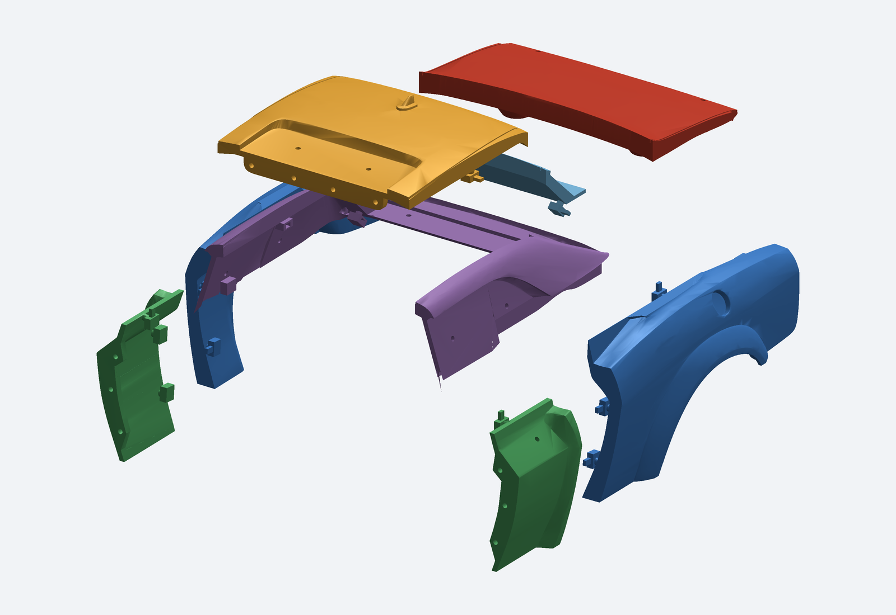
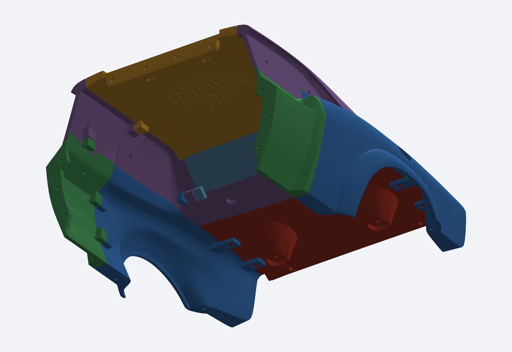

# Traseira modular — Rear Body V1

[BAIXAR PACOTE COMPLETO PARA FUSION](https://github.com/evildinomar2-dot/front-body-modular/raw/refs/heads/main/Traseira/Rear_Body_Modular_Fusion.zip)

Extraia o ZIP e abra `MONTAGEM_TRASEIRA_MODULAR.step` no Fusion. Inclui oito STEP individuais, oito STL, montagem, fontes, imagens, original preservado e relatórios de validação.

Oito componentes: tampa do porta-malas; dois painéis traseiros com arco de roda; dois trechos laterais dianteiros; painel do vidro traseiro; teto com antena; moldura/colunas. Sem reescala; unidade assumida em mm. A antena permanece com o teto.

Quatro pinos novos de Ø4 mm e alojamentos Ø4,6 mm posicionam a tampa removível; 12 pares de guias internas posicionam os demais painéis. A tampa não tem dobradiça. Folgas nominais de 0,30 mm por lado; impressão e montagem física ainda não testadas.

Os STEP são BRep facetados derivados de uma malha simplificada com tolerância-base de 0,06 mm. Não recuperam superfícies NURBS, esboços nem histórico paramétrico original. Oito sólidos individuais e montagem com oito sólidos reabertos com sucesso; 28 pares de contato conferidos dentro de tolerância numérica de 0,02 mm³. Retirada vertical da tampa testada em seis posições discretas, sem alegar uma varredura contínua. Verificações realizadas com CadQuery/OpenCascade e Manifold; não no próprio Fusion.

A traseira não foi alinhada nem unida à dianteira, e não recebeu adaptação ao chassi modificado. A dianteira anterior está preservada na pasta principal do repositório. Consulte [as instruções completas](INSTRUCOES.md).

